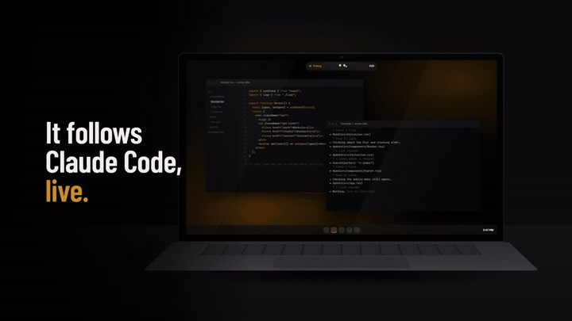

<h1 align="center">Pulse</h1>

<p align="center">
  <b>Your desk, with a pulse.</b><br>
  A small living island at the top of your screen that follows <b>Claude Code</b> live, asks before anything risky, and keeps your music, timers and notes one hover away.
</p>

<p align="center">
  <a href="https://github.com/im-Amrith/Pulse-releases/releases/latest"></a>
  <a href="LICENSE.txt"></a>
  <a href="https://github.com/im-Amrith/Pulse/actions/workflows/ci.yml"></a>
  
  <a href="https://github.com/im-Amrith/Pulse/stargazers"></a>
</p>

<p align="center">
  <a href="https://pulse-bot.dev">
    <picture>
      <source media="(prefers-reduced-motion: reduce)" srcset="promo/final/pulse-promo-poster.jpg">
      
    </picture>
  </a>
  <br>
  <sub>9 seconds from the <a href=".github/media/pulse-demo.mp4">promo film</a> (<a href="promo/final/pulse-promo-poster.jpg">still image</a>). All content shown is made up for the demo.</sub>
</p>

<p align="center">
  <a href="https://pulse-bot.dev">Website</a> ·
  <a href="https://github.com/im-Amrith/Pulse-releases/releases/latest">Download</a> ·
  <a href="#build-it-yourself">Build it yourself</a> ·
  <a href="#faq">FAQ</a> ·
  <a href="CONTRIBUTING.md">Contribute</a>
</p>

<p align="center">
  If Pulse saves you a trip to the terminal, a ⭐ <a href="https://github.com/im-Amrith/Pulse">star</a> helps others find it.
</p>

---

A black capsule hangs from the top centre of your screen with two eyes. They blink, glance at your cursor, scan while Claude works, hop when it needs you, smile when the job is done and droop when it fails. Hover over it (or press `Ctrl+Alt+P`, `Cmd+Alt+P` on a Mac) and it unfolds into a panel.

Free and open source (MIT), no account, and nothing leaves your computer.

## What it does

**Claude Code, live**
- The pill shows what Claude is doing right now: reading a file, editing, running a command.
- The **Claude Code** page has the session timer, the current step, a diff of the edit, command output, jobs done today and a model picker.
- **Permission requests**, `AskUserQuestion` choices and plans appear in the island with **Allow** / **Deny**, so you don't have to keep checking the terminal. You can also reply after Claude stops.
- The header shows your 5-hour usage and a countdown to the reset.

**Everything else, one hover away**

| Page | What it does |
| --- | --- |
| **Home** | Claude's live state, what's playing, your running timer and the next reminder |
| **Music** | Now playing from Spotify, browsers and other media apps, with seek, skip and **synced lyrics** in the pill |
| **Ask Pulse** | Ask your own Claude Code anything, or use quick actions on your last copied text or a screenshot |
| **Time** | Focus sessions, named timers and a stopwatch |
| **Plan** | A quick note with tickable lines, and reminders in plain words ("in 20 min", "tomorrow 9am") |
| **Launcher** | Pin apps, folders and websites |
| **Tray** | Drop files on the island and drag them out later; swap files with your phone by QR code (local network only) |
| **Clipboard** | Recent copies, click to copy again |

Pick your own colours in Settings. The island's accent and body colours follow your theme.

## Install

Download the latest build from **[pulse-bot.dev](https://pulse-bot.dev)** or the [releases page](https://github.com/im-Amrith/Pulse-releases/releases/latest).

- **Windows:** unzip `Pulse-win-x64.zip` and open `Pulse.exe`. Pulse isn't code-signed yet, so Windows may say "Windows protected your PC". Choose **More info**, then **Run anyway**.
- **macOS:** open `Pulse-mac-universal.dmg` and drag Pulse to Applications. It isn't notarized yet, so the first time go to **System Settings → Privacy & Security → Open Anyway**.

Then open the island and choose **Connect**. Pulse adds its hooks (and, if you don't already have one, a status line) to `~/.claude/settings.json` and keeps a backup next to it as `settings.json.pulse-backup`. **Disconnect** removes only Pulse's entries. Restart any Claude Code session that was already open.

Prefer not to run an unsigned binary? [Build it yourself](#build-it-yourself); it takes a few commands.

## Privacy

Pulse has no account, no analytics and no server of its own.

- Claude Code reports to Pulse through [hooks](https://docs.anthropic.com/en/docs/claude-code/hooks) sent to `127.0.0.1:47900`, a local-only address. Every request must carry a random per-install token (`src/main/hub.js`).
- **Ask Pulse** runs your own `claude -p`, using the Claude Code login you already have. Pulse never sees a password or an API key.
- **Lyrics** look up the song title, artist and length on [lrclib.net](https://lrclib.net). You can turn this off in Settings.
- **Update checks** ask GitHub for the latest version number.
- **Phone transfer** serves files on your local network at a random URL that stops after an hour.

That's the full list, and the code is here to check.

## Build it yourself

You need [Node.js](https://nodejs.org) 22 LTS. On Node 26, Electron's installer currently stops without unpacking Electron, so `npm start` can't find it.

```bash
git clone https://github.com/im-Amrith/Pulse.git
cd Pulse
npm install
npm start
```

`npm test` runs the tests (Node's built-in test runner, no extra setup).

**Optional on Windows:** `npm run helper` compiles the native media helper (`src/native/PulseMedia.cs`) with the C# compiler that ships with Windows; it needs the Windows 10/11 SDK. The helper uses about 20 MB of memory. Without it, Pulse falls back to a PowerShell bridge that uses about 90 MB.

**Release builds:** `npm run release` builds the Windows zip on a Windows PC.

Release zips are built on GitHub's machines, not on my computer. Pushing a `v*` tag runs [`windows.yml`](.github/workflows/windows.yml) (Windows zip) and [`mac.yml`](.github/workflows/mac.yml) (Mac `.dmg`) on GitHub Actions. Each run runs the tests, starts the built app once as a smoke test, and uploads the file with its `.sha256`. I check the build, then publish it to [Pulse-releases](https://github.com/im-Amrith/Pulse-releases/releases) by hand. You can compare a release's SHA-256 with the one in the workflow run that built it. (Up to 0.2.2 the Windows zip was built on my PC; the Windows workflow is used from the next release on.)

## How it works

```
Claude Code ──hooks (HTTP + token)──▶ hub.js ──IPC──▶ renderer (the island)
     ▲                                   │
     └──── pulse-reply.js (Stop hook) ◀──┘   your Allow / Deny / reply
```

| Path | What |
| --- | --- |
| `src/main/main.js` | App start, the transparent island window, tray, shortcuts |
| `src/main/hub.js` | Local hook server and session model; holds a `PermissionRequest` until you answer |
| `src/main/claude-config.js` | Connect and Disconnect in `~/.claude/settings.json` |
| `src/bin/pulse-status.js` | Status line: prints usage in the terminal and forwards it to the island |
| `src/bin/pulse-reply.js` | Background `Stop` hook that wakes Claude with a reply typed in the island |
| `src/main/media.js`, `media-mac.js` | Now playing and volume (native helper or PowerShell on Windows, AppleScript on macOS) |
| `src/native/PulseMedia.cs` | The small native Windows media helper |
| `src/main/lyrics.js` | Synced lyrics from LRCLIB |
| `src/main/ask.js` | Ask Pulse, through your own `claude -p` |
| `src/main/phone.js` | QR-code file transfer on the local network |
| `src/main/clipboard.js`, `downloads.js`, `system.js`, `store.js` | Clipboard history, Downloads watcher, Wi-Fi/CPU/RAM, JSON storage |
| `src/renderer/` | The island UI: `app.js` (pages), `eyes.js` (the eyes), `style.css` |
| `website/` | [pulse-bot.dev](https://pulse-bot.dev); `npm run deploy` publishes it to Cloudflare Pages |
| `promo/` | The promo video, made with [HyperFrames](https://github.com/heygen-com/hyperframes) from real footage (`npm run film -- --promo`) |

## FAQ

**Is it safe?**
Pulse only listens on `127.0.0.1` (your own computer), and every request must carry a random token made when Pulse is installed, so other programs and websites can't answer a permission request for you. It never runs a tool by itself: it passes your Allow or Deny back to Claude Code, and if you don't answer within 5 minutes the request goes back to the terminal. It has no account, no analytics and no server of its own (see [Privacy](#privacy)). It's a small codebase, so you can read it: start with `src/main/hub.js` and `src/main/claude-config.js`. Found a problem? See [SECURITY.md](SECURITY.md).

**What does Connect change?**
Only `~/.claude/settings.json`, and a backup goes next to it as `settings.json.pulse-backup` first. Connect adds:
- an HTTP hook for each Claude Code event Pulse shows (`SessionStart`, `UserPromptSubmit`, `PreToolUse`, `PostToolUse`, `PostToolUseFailure`, `PermissionRequest`, `Notification`, `Stop`, `StopFailure`, `SessionEnd`), all pointing at `http://127.0.0.1:47900/pulse/hook` with your token in an `X-Pulse-Token` header
- one background `Stop` command hook (`pulse-reply.js`) so you can reply to Claude from the island
- a status line (`pulse-status.js`), only if you don't already have one

Disconnect removes exactly those entries and leaves your own hooks and status line alone. The model picker in the island writes the `model` setting in the same file.

**Why Electron?**
The island is a transparent, always-on-top window with animation, blur and a lot of small UI, and Electron let one person ship it on Windows and macOS from one plain-JavaScript codebase with no build step. The cost is memory: about 315 MB right after launch on Windows. 0.2.1 cut that from about 530 MB, mostly by replacing a PowerShell media bridge with a 12 KB native helper. If you can make it lighter, a PR is very welcome.

**Why aren't the builds signed?**
Code signing costs money every year (a Windows signing service and the Apple Developer Program), and Pulse is free. So Windows SmartScreen warns the first time, and macOS needs **Open Anyway**. Signing is planned. Until then, the builds are made on GitHub's machines (see [Build it yourself](#build-it-yourself)), each release lists its SHA-256, and you can always build Pulse from source yourself.

**Does it run on Linux?**
Not yet, and nobody has tried it on a Linux desktop. Most of Pulse is plain Node and Electron, but the media bridge, Wi-Fi status, a transparent always-on-top window that behaves across desktop environments, and packaging all need work. If you'd like to help, see [Investigate Linux support](https://github.com/im-Amrith/Pulse/issues/9).

**Is this an official Anthropic app?**
No. Pulse is an independent project for Claude Code. It isn't affiliated with or endorsed by Anthropic.

## Contributing

Bug reports, ideas and pull requests are welcome. See [CONTRIBUTING.md](CONTRIBUTING.md), and look for issues labelled [`good first issue`](https://github.com/im-Amrith/Pulse/labels/good%20first%20issue) if you'd like somewhere to start. Please follow the [Code of Conduct](CODE_OF_CONDUCT.md). To report a security problem, see [SECURITY.md](SECURITY.md). Changes between versions are in [CHANGELOG.md](CHANGELOG.md).

## License

[MIT](LICENSE.txt) © 2026 Amrithesh S Menon.

These files aren't covered by the MIT License:
- **Website background videos:** `website/assets/silk.mp4`, `ribbon.mp4`, `doorway.mp4` and `silk.jpg` come from third-party media libraries and remain their owners' property.
- **Barlow Condensed font:** licensed under the SIL Open Font License (`promo/shared/fonts/OFL-BarlowCondensed.txt`).

The published builds and website also come with [Terms of Use](TERMS.txt).

Pulse is an independent project. It is not affiliated with or endorsed by Anthropic. Claude and Claude Code are trademarks of Anthropic, PBC.
